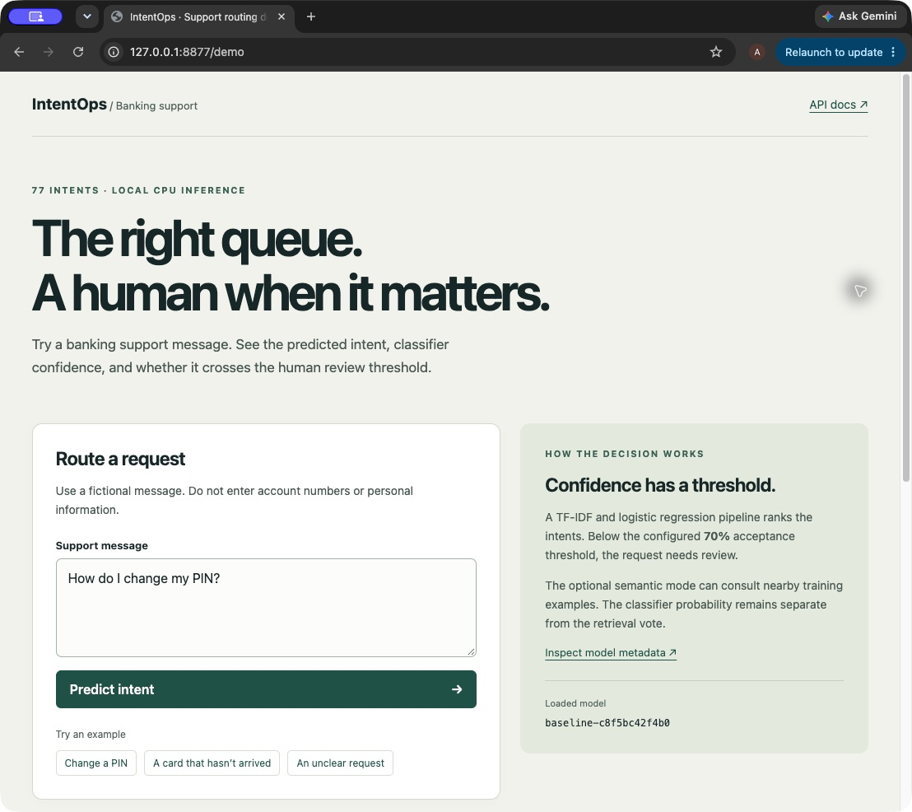
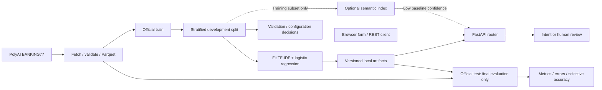

# IntentOps — ML-Powered Intent Classification & Human-Review Routing

**77 intents · 87.63% test accuracy · 0.8772 macro F1 · 71 passing offline tests**

**Status: verified locally; public deployment pending approval.**
Try the browser demo at `http://localhost:8000/` after starting the app.
[60-second walkthrough and resume bullets](docs/DEMO.md) ·
[deployment runbook](docs/DEPLOYMENT.md) · [audit](docs/AUDIT.md)

Customer-support requests often differ by only a few words: a missing card, a declined
payment, and a delayed transfer need different queues. IntentOps learns 77 banking
intents from the public BANKING77 dataset and routes uncertain predictions to human
review. It uses a cheap TF-IDF/logistic-regression baseline, with optional local
sentence-embedding retrieval for uncertain requests. No paid API or LLM is involved.

This is an ML system beyond a notebook: data provenance and checksums, reproducible
splitting, serialized preprocessing, held-out evaluation, bounded API contracts,
privacy-conscious logs, offline tests, CI, and a non-root container are all included.
It is a compact, production-style demonstration, not a claim of operational maturity.



[View the real routing-result screenshot](docs/images/demo-result.png). These images
were captured from the running local app; the displayed routing time is one request,
not a benchmark.



## Features and structure

The readiness audit passed **71 offline tests with 98.74% branch-aware coverage**,
Ruff and mypy in both the working environment and a fresh non-editable installation.
Fresh training/evaluation reproduced the saved quality metrics. The Linux arm64
container passed constrained local smoke checks. Native amd64 CI and public hosting
verification remain pending; see the [audit evidence](docs/AUDIT.md).
The release CI also builds and smoke-tests the frozen Docker image when its artifacts
are present. It performs no production training or dataset/model downloads.

- Word unigrams/bigrams, sublinear TF, minimum document frequency 2, logistic regression.
- Configurable review gate; baseline probabilities are **not assumed calibrated**.
- Optional cosine neighbours with weighted voting and separate acceptance criteria.
- Browser demo at `/`, `/health`, `/metadata`, `/predict`, `/batch-predict`, and `/docs`.
- Accuracy, macro/weighted F1, top-3, confusion matrix, error exports, and coverage tradeoffs.
- Synthetic offline tests, Ruff, mypy, CI, Docker, and an explicitly scoped benchmark.

```text
src/intentops/
  config.py       # Training defaults and environment settings
  data.py         # Schema validation, splitting, checksums
  model.py        # One sklearn pipeline; train/save/load/top-k
  semantic.py     # Lazy optional encoder and reloadable cosine index
  router.py       # Confidence gates and privacy-conscious inference events
  metrics.py      # Shared quality and selective-accuracy helpers
  schemas.py      # Bounded Pydantic contracts
  api.py          # App factory and lifecycle
  demo.py         # Escaped server-rendered form; same router as the API
  http.py         # Bounded transport body reader
  serve.py        # PORT-aware single-worker launcher
  templates/      # Demo HTML
  static/         # Demo CSS; no frontend framework or JavaScript
  logging.py      # JSON application logs
scripts/          # fetch_data.py, train.py, evaluate.py, benchmark_api.py
tests/            # Synthetic fixtures; no model/data downloads
data/raw/         # Generated train/test Parquet and manifest
artifacts/        # Generated baseline.joblib, metadata.json, optional semantic.npz
reports/          # Generated results; README.md documents report schemas
docs/             # Audit, approval-gated hosting runbook, demo and resume bullets
requirements-runtime.txt  # Frozen baseline-compatible runtime dependencies
render.yaml       # Prepared free-plan configuration; not applied
.github/workflows/ci.yml
```

## Quickstart

Run from the repository root with Python 3.11+. Data download requires internet;
ordinary baseline training, evaluation, and inference use local files.

With the current local artifacts, the shortest path is:

```bash
source .venv/bin/activate
python -m intentops.serve
```

Open `http://localhost:8000/`. Use the example links, submit a prediction, and inspect
the review flag and alternatives. For a clean source checkout, create a new environment,
install the pinned runtime and fetch/train the artifacts:

```bash
python3.11 -m venv .venv
source .venv/bin/activate
python -m pip install -r requirements-runtime.txt -e ".[dev,data]"
python scripts/fetch_data.py
python scripts/train.py
# Use validation to examine thresholds/configuration before the final test run:
python scripts/evaluate.py --split validation
python scripts/evaluate.py
python -m intentops.serve
```

If `python3.11` is unavailable, install a supported Python interpreter first.
The required base developer installation is `python -m pip install -e ".[dev]"`;
add `-r requirements-runtime.txt` to reproduce the saved baseline's runtime.
The `data` extra adds Hugging Face Datasets **only for fetching**. It is not needed
by the service. The equivalent Make targets are `make install`, `make data`,
`make train`, `make evaluate`, and `make run`; activate the venv first.

```bash
python -m ruff check .
python -m ruff format --check .
python -m mypy
python -m pytest
# Equivalents: make lint typecheck test
python scripts/benchmark_api.py --warmup 20 --requests 200
```

The benchmark requires the `dev` extra (`httpx`). It measures sequential,
in-process FastAPI TestClient round trips, including validation, routing, logging,
serialization and thread bridging. It excludes network transport, startup, and
concurrent load. Results and environment go to `reports/benchmark.json`; do not
interpret these as network/service SLA measurements.

## API and routing

The browser form at `/` uses the same router and Pydantic validation as `/predict`.
It has preset fictional examples, an escaped result display, no application storage,
and no JavaScript. The body limit is 1 MiB; oversize requests return HTTP 413.

```bash
curl -fsS http://localhost:8000/health
curl -fsS http://localhost:8000/metadata
curl -fsS http://localhost:8000/predict \
  -H 'Content-Type: application/json' \
  -d '{"text":"I am still waiting for my card"}'
curl -fsS http://localhost:8000/batch-predict \
  -H 'Content-Type: application/json' \
  -d '{"texts":["How do I change my PIN?","My transfer is delayed"]}'
```

`/predict` returns `intent`, `confidence`, `needs_review`, `top_k` (intent/probability
pairs sorted descending), `model_version`, `latency_ms`, and `source`. Semantic
matches and vote are present only when retrieval actually runs. Batch responses
wrap the same objects in `predictions`. Text must be a nonblank string of at most
2,000 characters after trimming; batches contain 1–32 texts. Validation errors
return HTTP 422. Missing or invalid model files leave `/health` at HTTP 503 with
an actionable message; predictions and metadata also return 503.

Baseline mode accepts when maximum probability is **at least** the review threshold
(default 0.70); otherwise `needs_review=true`. This probability is a classifier
score, not a guarantee of correctness or an out-of-domain detector. The predicted
intent is still returned for human triage. No probability calibration is fitted.

Hybrid mode consults the five nearest training examples only below that gate.
Negative cosine similarities receive zero vote weight. The voted label is accepted
only if the nearest similarity is at least 0.65 **and** its normalized label vote
is at least 0.70. Otherwise the baseline suggestion stays under review.
`confidence` and `top_k` always describe the baseline distribution, even when
`source="semantic"` changes the selected intent; `semantic_vote` is a separate,
uncalibrated vote share. Similarity is not a probability.

| Environment variable | Default |
| --- | --- |
| `PORT` (launcher/container) | `8000` |
| `INTENTOPS_ARTIFACT_DIR` | `artifacts` |
| `INTENTOPS_REVIEW_THRESHOLD` | `0.7` |
| `INTENTOPS_SEMANTIC_ENABLED` | `false` |
| `INTENTOPS_SEMANTIC_MIN_SIMILARITY` | `0.65` |
| `INTENTOPS_SEMANTIC_MIN_VOTE` | `0.7` |

`/metadata` exposes the loaded model's name/version, class count, routing thresholds,
and semantic availability/enabled state. Availability means a usable index is loaded
in this service process, not merely that a file exists on disk. Model initialization
occurs during application lifespan, never as an import side effect.

## Data and evaluation policy

The official 10,003-row training split is development data. We split it 80/20,
stratified by intent with `random_state=42`. Only the resulting training subset
fits the vectorizer, classifier, or semantic index. Validation is reserved for
configuration and threshold decisions. The saved classifier is **not** refitted
on all development data, keeping validation and hybrid comparisons interpretable.
No expensive hyperparameter search is implemented.

The official 3,080-row test split stays untouched until final evaluation. Fetching
preserves row order, text, duplicate rows, and labels. Never fit on test data,
remove test examples, or select thresholds using test labels. Freeze your routing
settings before running `evaluate.py` with its default `--split test`.

`fetch_data.py` uses the Hugging Face Datasets packaged CSV builder on pinned,
original PolyAI CSV files and maps integer `ClassLabel` values to intent names from
pinned `PolyAI/banking77` metadata. This avoids executing the dataset's deprecated
remote Python loader, which current Datasets versions no longer support.
`data/raw/manifest.json` records the dataset name, source revisions/URLs, row counts,
77 names and SHA-256 checksums. Parquet output is deterministic for the same inputs
and dependency versions; serializer upgrades may change bytes. Preserve the manifest
and environment alongside any published results.

Training saves `artifacts/baseline.joblib` and `artifacts/metadata.json`, including
configuration, split sizes, seed, labels, validation metrics, runtime/package versions,
and a model checksum. The checksum-derived version binds semantic indexes to that
baseline. Retraining without `--semantic` removes any previous index.

Evaluation reports accuracy, macro F1, weighted F1, top-3 accuracy, a confusion matrix
with explicit label ordering, and common **directed** confusion pairs. Reviewed
examples still count in overall accuracy: routing does not erase mistakes.
Top-3 is computed from the baseline distribution, with stable class-order tie breaking.

For thresholds 0.50/0.60/0.70/0.80/0.90, `selective_accuracy.csv` reports the accepted
fraction (coverage), accuracy among accepted examples, accepted count, and review
count. With zero accepted examples, accepted accuracy is blank rather than zero.
Higher thresholds usually exchange automation coverage for reliability, but monotonic
accuracy is not guaranteed. No threshold is called optimal: define a review capacity
or error-cost objective, then choose on **validation** and freeze it for test.

### Results and error analysis

A local baseline run on **2026-10-21** produced these measured results, using the
unchanged defaults and model version `baseline-c8f5bc42f4b0`:

| Split | Rows | Accuracy | Macro F1 | Weighted F1 | Top-3 accuracy |
| --- | ---: | ---: | ---: | ---: | ---: |
| Validation | 2,001 | 87.26% | 0.8743 | 0.8727 | 96.20% |
| Official test | 3,080 | 87.63% | 0.8772 | 0.8772 | 96.17% |

At the preconfigured 0.70 gate, the test run accepted 1,397 requests (45.36%
coverage) with 99.00% accepted accuracy and routed 1,683 to review. This illustrates
the coverage tradeoff; it does not establish an optimal threshold. The official test
labels were not used to choose these settings.

The warmed in-process benchmark measured p50 **0.85 ms** and p95 **1.43 ms** over
200 requests after 20 warmups on macOS arm64 / Python 3.11.17. These are local
TestClient timings, not network service latency. The training runtime used
scikit-learn 1.9.1, pandas 2.3.3, NumPy 2.4.6 and joblib 1.6.0. Semantic weights
were not downloaded for this run, so no real hybrid quality claim is made.

Generated files are local, ignored by Git, and recreated by the commands above.
The exception is [reports/summary.json](reports/summary.json), a versioned aggregate
snapshot with model/data hashes and no example text. An audit re-evaluation of the
unchanged frozen model exactly reproduced the saved test metrics and confusion matrix.
Full precision, environment details and per-example errors are available in the
following outputs; see [report schemas](reports/README.md):

- `reports/metrics.json`: measured baseline and, when available, hybrid results.
- `reports/selective_accuracy.csv`: baseline coverage/accepted-accuracy tradeoff.
- `reports/confusion_pairs.csv` and `reports/errors.csv`: confusion counts and mistakes.
- `reports/benchmark.json`: measured local timing with explicit scope.
- `artifacts/metadata.json`: development validation results and training provenance.

Start error analysis with the most frequent directed confusion pairs. Inspect their
texts, confidence and alternatives; separate ambiguous wording, missing vocabulary,
overlapping intent definitions and plausible annotation issues. Compare high-confidence
mistakes against low-confidence mistakes. Develop changes on validation, then perform
a fresh final test evaluation only after decisions are frozen. Do not rewrite labels
solely because this model disagrees with them. Public benchmark errors may contain
dataset text; private-data error exports require appropriate access controls.

### Optional baseline vs. hybrid comparison

```bash
python -m pip install -e ".[semantic]"
# This explicit build may download the configurable encoder weights:
python scripts/train.py --semantic \
  --semantic-model sentence-transformers/all-MiniLM-L6-v2
python scripts/evaluate.py --split validation --review-threshold 0.70 \
  --semantic-min-similarity 0.65 --semantic-min-vote 0.70
# Freeze the above settings before final evaluation:
python scripts/evaluate.py --review-threshold 0.70 \
  --semantic-min-similarity 0.65 --semantic-min-vote 0.70
INTENTOPS_SEMANTIC_ENABLED=true python -m uvicorn intentops.api:app --port 8000
```

If `semantic.npz` exists, evaluation explicitly compares baseline and hybrid on the
same split, reports accuracy delta, hybrid coverage/accepted accuracy, semantic usage,
and exports hybrid predictions/confusions. Hybrid has no unified top-3 distribution;
its top-3 metric is null with an explanation. The baseline metrics always remain
available. An accuracy decrease is a loss and should be reported as such; fallback
has no presumed quality benefit. Account for coverage and latency as well as accuracy.

The encoder is lazy-loaded and uses local cached weights during serving/evaluation;
only the explicit semantic build permits a download. Keep that cache available to
the serving user. No Sentence Transformer weights are downloaded in tests or CI.

## Deployment

For local development, run `make run` or `python -m intentops.serve`. It honors `PORT`,
loads the baseline once, disables URL access logging, and bounds concurrency at 16.
CPU prediction runs in the worker thread pool; batches process sequentially.
`.env.example` documents public settings; the app reads environment variables rather
than automatically loading `.env`. No secrets are required.

Build **after** producing the baseline and metadata on a compatible Python/sklearn
environment:

```bash
docker build -t intentops:local .
docker run --rm -p 8000:8000 intentops:local
# Equivalents: make docker-build docker-run
```

The patch-version slim Python image installs pinned runtime dependencies only, runs
as UID 10001, and checks `/health` on the configured port. The build context is
allowlisted. It includes only the baseline and metadata; optional semantic
serving requires a deliberate image extension adding the semantic dependency, index
and encoder cache. Raw data, tests, notebooks, secrets and caches are excluded.
The loader rejects a different sklearn version before deserialization. Runtime pins
and artifacts must be updated together; these pins are not a universal lockfile.

The simplest public-demo option is one Render Free Docker web service. The 5.43 MiB
baseline needs CPU only. A local model-load process peaked at 187.7 MiB; Linux container
memory and concurrency still need verification. Render Free provides 512 MB RAM /
0.1 CPU ([specs](https://render.com/docs/compute-plans)), but sleeps after 15 idle minutes,
has cold starts and usage limits ([limits](https://render.com/docs/free)). An always-on
0.5 CPU / 512 MB instance is listed at $7/month as of 2026-10-21
([pricing](https://render.com/pricing)); paid resources require approval.

`python scripts/package_demo.py` prepares a local allowlisted `demo-release/` with
the frozen baseline, aggregate metrics and deployable source. It uploads nothing.
See [exact deployment steps](docs/DEPLOYMENT.md) for repository handoff, health checks,
environment settings, secrets handling, Docker resource checks and live URL verification.
`render.yaml` is prepared configuration only. On 2026-10-22, the Linux arm64 image passed
health and inference checks with a read-only root, UID 10001, 512 MiB RAM and 0.5 CPU.
One post-test memory sample was 137.3 MiB; this was not a peak/load measurement. The
amd64 image builds, but local QEMU crashes during sklearn import on Apple Silicon;
native amd64 CI/hosting validation remains required. No cloud signup, paid resource
or public deployment is claimed.

## Provenance, privacy and limitations

Project code is available under the [MIT license](LICENSE). Dataset and artifact
attribution is recorded separately in [NOTICE.md](NOTICE.md).

[BANKING77](https://huggingface.co/datasets/PolyAI/banking77) is published by PolyAI
under [CC BY 4.0](https://creativecommons.org/licenses/by/4.0/). Credit Iñigo Casanueva,
Tadas Temčinas, Daniela Gerz, Matthew Henderson and Ivan Vulić,
[Efficient Intent Detection with Dual Sentence Encoders (2020)](https://arxiv.org/abs/2003.04807).
The [original data](https://github.com/PolyAI-LDN/task-specific-datasets/tree/master/banking_data)
is converted to Parquet with human-readable intents; no annotation corrections are made.
Dataset licensing/attribution remains applicable to redistributed data and derived work.

Ying and Thomas's [Label Errors in BANKING77 (2022)](https://aclanthology.org/2022.insights-1.19/)
identified **potential** annotation issues using automated methods. This motivates
careful error inspection; it is not definitive proof that a fixed fraction of labels
is wrong. We preserve the official benchmark unchanged.

Inference logs contain event ID, model version, intent, classifier confidence, review
state, source and latency. **Raw request text is not logged by default**, because support
messages can include account details and other sensitive information. Semantic matches
return indexed examples to the caller; use only data suitable for that audience.
No request text is sent to a third-party API. Load joblib artifacts only from trusted
sources: pickle-based formats can execute code. Checksums detect mismatched bundles,
not malicious publishers. There is no authentication in the app itself.

Known limits: English banking intents only; no out-of-scope class, calibrated uncertainty,
fairness guarantee, drift monitor, persistence of human decisions or external review
queue. Retrieval can reinforce annotation mistakes and increase latency. Similar user
phrases across splits may make benchmark performance optimistic. Results on this public
dataset do not establish real support-domain performance.

## Interview discussion topics

- Why fit TF-IDF inside a Pipeline, and how does that prevent leakage?
- How does a review threshold trade automation for accepted accuracy and reviewer load?
- Why can a confident closed-set classifier still fail on unfamiliar requests?
- When does semantic voting help or hurt, and what evidence establishes that?
- How do provenance, artifact versions, tests and health states support deployment?
- How would you investigate label noise without changing the benchmark to suit the model?
