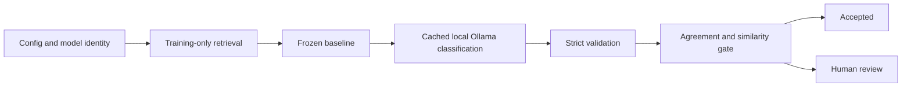

# Phase 2: local LangGraph and retrieval evaluation

This is an optional, local experiment on Apple M5 / 16 GiB unified memory. It does
not change the baseline API, demo, transformer path, Docker image or Render deployment.
No hosted inference, API keys, paid services or API usage ledger are used. API cost is
**$0.00**; local compute, electricity, disk space and download bandwidth are not free
resources. No hosted-API exception to AGENTS.md applies.

## Final measured outcome

The frozen pilot configuration completed full validation and a single final official
test evaluation. Only τ was selected on validation; no model was retrained and no
prompt/configuration was retuned using test results. The 250 pilot responses were
verified cache hits and the remaining 1,751 validation requests were live. Every
test classification was live (3,080 calls, no response-cache hits).

| Path | Validation accuracy | Macro F1 | Weighted F1 | Test accuracy | Macro F1 | Weighted F1 |
| --- | ---: | ---: | ---: | ---: | ---: | ---: |
| Frozen baseline | 87.2564% | 0.874325 | 0.872686 | 87.6299% | 0.877201 | 0.877201 |
| Frozen transformer | 89.9050% | 0.893909 | 0.899004 | 88.9610% | 0.888488 | 0.888488 |
| Local LLM/RAG | 92.1539% | 0.923046 | 0.922085 | 92.9870% | 0.929340 | 0.929340 |

The baseline and transformer reproduce their published 87.63% / 88.96% test accuracy
exactly. The selected threshold is **τ = 0.8959192633628845**. Validation accepted
1,018/2,001 rows (50.8746% coverage), with 1,008 correct: **99.0177% accepted accuracy**,
Wilson 95% **98.2013%–99.4656%**. It maximizes coverage among eligible thresholds
under the predeclared >=99% accuracy / >=400-support rule. The validation target
status is **MET**, using point accuracy rather than a confidence lower bound.

On the independent test, the same frozen τ accepted 1,731/3,080 rows (56.2013%
coverage), with 1,704 correct: **98.4402% accepted accuracy**, Wilson 95%
**97.7401%–98.9258%**. **The 99% accepted-accuracy target did not generalize to test.**
The threshold and prompt were left unchanged. There were zero invalid outputs,
provider failures or unknown token fields in both full validation and test.

On Apple M5 / 16 GiB, test live retrieval mean/p95 was 0.0101/0.0202 s,
LLM/cache-write 1.4513/1.9600 s, and end-to-end 1.4689/1.9826 s. The 3,080 calls
returned 4,190,788 prompt-evaluation tokens, 30,778 generated tokens and 3,153,605
cached-prompt tokens as reported by Ollama. Prefix-cache counts are distinct from
response-cache hits. API cost was **$0.00**, not a statement about electricity cost.

The test monotonic graph-loop duration (`perf_counter`) is 4,648.667 s (77.48 min),
and monotonic overall duration including setup/comparisons is 4,661.695 s (77.69 min).
However, the completed attempt's timestamps span **10,956.575 s (182.61 min)**.
Suspension/clock-adjustment status was not captured and the cause is unverified;
these measurements must not be presented as equivalent calendar elapsed time.
Validation records 3,731.791 s monotonic graph-loop and 3,744.560 s overall; an exact
absolute validation start timestamp was not captured, so its calendar duration is
PENDING. Local per-request latencies are not production SLAs or hosted API timings.

The evaluator was committed as `07fc76e4f747ea17cf104651b0616403c64b2eaf` before
validation. The freeze receipt predates test access and binds that commit, prompt
and schema hashes, model digest, k, embedding revision and τ. The completed ignored
attempt receipt remains unchanged. Its original export checksum is verifiable
against ignored `reports/llm-runs/final-test/export-at-completion.json`; the public
comparison adds a post-run clock audit without changing results or configuration.

Final local verification: **133 tests passed**, **98.34%** branch-aware coverage;
Ruff, format checks and mypy passed. The base environment without torch, LangGraph
or Chroma passes **126 tests**, skips seven optional tests, and reaches **86.32%**
coverage; its mypy check passes. All frozen evaluator source hashes still match the
receipt. All 42 original tracked source/script/test/deployment/artifact files remain
byte-identical to `e933d0c`, and the ignored transformer checkpoint still matches its
recorded checksums. No datasets, indexes, caches or model binaries are committed.

## Fixed model identities

- Ollama tag: `qwen2.5:7b-instruct-q4_K_M` (7.62B parameters, Q4_K_M, Apache 2.0).
- Manifest SHA-256:
  `845dbda0ea48ed749caafd9e6037047aa19acfcfd82e704d7ca97d631a0b697e`.
- Registry layer/config download: 4,683,087,332 bytes (about 4.7 GB). The bounded
  4,096-token context limits additional memory use. Local residency is recorded in
  the pilot JSON; available system memory also depends on other running apps.
- Embedding model: `sentence-transformers/all-MiniLM-L6-v2`, revision
  `1110a243fdf4706b3f48f1d95db1a4f5529b4d41`, CPU, normalized embeddings.
- Ollama server verified: `0.40.16`. A synthetic local request successfully enforced
  the `format` JSON schema. The measured experiment uses **JSON-schema constrained
  output**, not the parser-only fallback.

The Qwen model was selected for its instruction following and documented JSON output
support, not an unmeasured claim of banking accuracy. The exact manifest digest is
verified before each graph request. A missing or changed model stops the run; there
is no alias fallback, cloud fallback or silent substitution.

Sources: [Qwen Ollama model](https://ollama.com/library/qwen2.5:7b-instruct-q4_K_M),
[Qwen upstream card/license](https://huggingface.co/Qwen/Qwen2.5-7B-Instruct),
[Ollama structured output](https://docs.ollama.com/capabilities/structured-outputs).

## Architecture and data boundary



The LangGraph is acyclic and bounded, with no agents, tools, retries or autonomous
actions. Gold labels enter only the evaluator, never the graph or classification
prompt. Shell-based LangSmith/LangChain tracing is disabled by the graph; Chroma
telemetry is disabled. No default Chroma encoder is allowed (`embedding_function=None`).

The unchanged official 10,003-row training split is stratified 80/20 with seed 42:
8,002 fitting rows and 2,001 validation rows. Existing loaders verify its checksum,
the same 77 label names as a set, and the baseline's canonical order. Integer label
orders are never trusted. Only `train.parquet` is opened. Reading the existing
manifest's test checksum is provenance, not access to test contents.

Chroma PersistentClient uses two cosine collections: all 8,002 fitting examples and
77 authored descriptions in `configs/intent-descriptions-v1.json`. Descriptions were
authored from the label taxonomy, not validation/test examples. Query retrieval uses
k=5 training examples plus descriptions for their candidate intents. All 77 canonical
labels remain legal output choices. Validation and official test examples are never
indexed. Binding metadata ties the index to the baseline checksum, training checksum,
manifest, ordered labels, fitting row IDs, description checksum and embedding revision.
HNSW retrieval is approximate; ties/implementation changes can affect neighbors.

Ollama receives explicit `temperature=0`, `seed=42`, `num_ctx=4096`, `num_predict=48`,
and a schema requiring exactly one `intent` field from the canonical enum, with
`additionalProperties=false`. Seed and temperature do not guarantee bitwise
reproducibility across hardware or runtime versions. The strict-parser implementation
exists only for an explicitly recorded unsupported-schema environment; it requires
an exact bare canonical label. No fallback was needed in this run.

Malformed JSON, extra/duplicate keys, unknown labels, refusals, transport failures and
truncated responses yield `intent=null` and human review. They remain in all quality
denominators. An invalid prediction is a false negative for its true canonical class;
macro and weighted F1 use the same 77-label set. Nothing is silently remapped.

## Gate and historical pilot scope

Acceptance requires a valid LLM label agreeing with both the frozen baseline and the
nearest retrieved fitting label, with nearest cosine similarity **greater than τ**.
The validation objective was to explore 99% accepted accuracy while reporting
coverage, support and uncertainty. No LLM self-reported confidence is used.

**τ was PENDING during the pilot.** All pilot rows therefore routed to review.
The historical pilot report separately shows agreement-only candidate support, coverage,
accuracy, similarity diagnostics and a 95% Wilson interval. These are diagnostics,
not a demonstrated operating point or a 99% guarantee.

The 20-example smoke gate uses seed-42 proportional largest-remainder quotas and
necessarily covers only 20 of 77 labels. Accuracy/F1 are neither computed nor reported
for this smoke run. Its mean live end-to-end latency must be at most 10 seconds
before the 250-row pilot can start. Pilot sampling uses the same quota method, covers
all 77 intents, and records row IDs and SHA-256 hashes without exporting support text.

The frozen baseline, frozen transformer and LLM/RAG path were evaluated on exactly
the same 250 pilot validation examples, without retraining. Those quality comparisons
apply only to that exploratory sample. The official test split remained unopened
until the separately approved final protocol below, after full validation and freeze.

## Setup and reproduction

Install [Ollama for macOS](https://ollama.com/download/mac) manually, move it to
Applications and open it. Allow its CLI setup if prompted. Alternatively, if Homebrew
already exists, run `brew install ollama` and `ollama serve`. Do not run a second
server if the macOS app is already serving on localhost. No account or cloud model
is needed. Download the exact local tag:

```bash
ollama --version
curl http://127.0.0.1:11434/api/version
ollama pull qwen2.5:7b-instruct-q4_K_M
curl http://127.0.0.1:11434/api/tags
```

Compare the full returned digest with the pin above. If it differs, stop; do not update
the pin automatically. Work inside the existing `demo-release/` Git checkout, on
`feat/llm-rag-path`. Do not initialize Git in its parent workspace.

```bash
python3.11 -m venv .venv
source .venv/bin/activate
python -m pip install -r requirements-runtime.txt -e ".[dev,transformer,llm]"
# Optional experiment versions measured here (not serving dependencies):
python -m pip install langgraph==1.2.20 chromadb==1.5.9 \
  sentence-transformers==5.7.0 httpx==0.28.1 filelock==3.32.7

# Explicit one-time embedding download; subsequent loading is local-only:
python - <<'PY'
from huggingface_hub import snapshot_download
snapshot_download(
    "sentence-transformers/all-MiniLM-L6-v2",
    revision="1110a243fdf4706b3f48f1d95db1a4f5529b4d41",
    cache_dir=".hf-cache",
    allow_patterns=["*.json", "*.txt", "model.safetensors", "1_Pooling/*"],
)
PY

export HF_HUB_OFFLINE=1 TRANSFORMERS_OFFLINE=1 TOKENIZERS_PARALLELISM=false
export LANGCHAIN_TRACING_V2=false LANGSMITH_TRACING=false OTEL_SDK_DISABLED=true

python scripts/build_index.py --data-dir ../data/raw
python scripts/evaluate_llm.py --mode smoke --data-dir ../data/raw
# Proceed only after a passing smoke report:
python scripts/evaluate_llm.py --mode pilot --split validation --data-dir ../data/raw
```

The existing local frozen transformer must be present at `artifacts/transformer/`;
its baseline/data bindings, label order and checkpoint checksums are checked. This
phase never trains or downloads a replacement transformer. A fresh public checkout
does not contain that ignored checkpoint. Preserve/copy the trusted Phase 1 bundle
locally; otherwise the three-way comparison cannot reproduce and must stop.

Likewise this session reuses the verified dataset at `../data/raw`, without fetching
it again. All index/model loading during evaluation is local-only. Existing indexes,
ledgers and reports are never overwritten by the CLIs. Reproduction requires new
`--index-dir`, `--run-dir` and `--report` paths, with a matching `--smoke-report` when
needed. Reusing `--cache-dir` returns cached classifications, reported separately;
use a fresh ignored cache directory when deliberately measuring new live calls.

## Evidence and compute accounting

- [Final three-way comparison](../reports/llm_vs_baseline_transformer.md)
- [Full final evidence and clock audit](../reports/llm_vs_baseline_transformer.json)
- [Pre-test freeze receipt](../reports/llm_freeze.json)
- [Full validation and exhaustive threshold sweep](../reports/llm_full_validation.json)
- [20-row smoke report](../reports/phase2_smoke.md)
- [250-row pilot report](../reports/phase2_pilot.md)
- [Machine-readable pilot evidence](../reports/phase2_pilot.json)

Every completed example records Ollama's `prompt_eval_count`, `eval_count`, optional
`prompt_eval_cached_count`, returned durations and local retrieval/baseline/LLM/end-to-end
wall times. Missing usage is explicitly unknown, not zero. Response-cache hits replay
historical token counts and are never counted as new model work. Prefix-cache tokens
reported by Ollama are distinct from response-cache hits.

Atomic JSON replacement and file locks protect response caches. Cache keys cover the
exact model digest/tag, Ollama version, endpoint, all generation settings, prompt/schema
versions and contents, canonical labels, retrieved examples, request hash and index
binding. Keys never contain raw text in filenames. Private indexes and ignored caches
contain dataset examples; they must not be published. Console and versioned reports
contain no raw support text. Per-run compute ledgers are ignored.

Timing is sequential, batch size 1, on this local Mac. Stage means/p95 and sample
counts are separate for live calls and response-cache hits. Model initialization is
excluded from per-row timings; cold model loads within a request are included and
recorded. Total graph-loop wall time additionally includes ledger writes. Overall
pilot wall time also includes setup and the baseline/transformer comparisons.
These timings differ from Phase 1's shared CPU protocol and from hosted API latency.

Projected full-validation (2,001 rows) and final-test (3,080 rows) times multiply live
mean and p95 by each row count. This is a planning range, not a confidence interval
on total time, and excludes setup, pauses, cache hits and future thermal/load changes.

## Historical pilot and offline verification

The measured pilot completed on Apple M5 / 16 GiB, with CPU MiniLM/DistilBERT and
local Ollama. Ollama reported 4,755,397,016 bytes of GPU-resident model memory and
4,096 context tokens. The 20-live-row smoke mean/p95 was 1.514/1.762 seconds with
zero invalid outputs. No accuracy was computed for the smoke gate.

The pilot covered all 77 intents across 250 validation rows: 230 live calls plus
20 response-cache hits reusing the smoke responses. Live retrieval mean/p95 was
0.110/0.317 s; LLM/cache-write mean/p95 2.270/3.325 s; end-to-end mean/p95
2.452/3.599 s. Pilot graph-loop time was 575.887 s, and setup/comparisons plus that
loop took 580.350 s. The 230 new calls returned 313,838 prompt-evaluation tokens,
2,302 generated tokens and 235,087 cached-prompt tokens as reported by Ollama;
these raw fields are preserved rather than reinterpreted as billed usage.
There were zero invalid outputs or provider failures and no unknown usage fields.

Agreement-only support was 201/250 (80.4%), with 197/201 correct (98.01%; 95% Wilson
interval 95.00%–99.22%). Pilot operational acceptance was zero because τ was PENDING.
At the pilot's measured live mean/p95, a new 2,001-row validation pass projected to
81.78–120.02 minutes, and a 3,080-row final-test pass to 125.88–184.74 minutes.
Neither projected run had been performed at that point. The later approved final
measurements above supersede those time projections; baseline/transformer weights
were loaded only.

```bash
python -m ruff check .
python -m ruff format --check .
python -m mypy
HF_HUB_OFFLINE=1 TRANSFORMERS_OFFLINE=1 HF_DATASETS_OFFLINE=1 python -m pytest
```

New tests use synthetic text, fake encoders/retrievers/providers and HTTP mock
transports. They never download weights or run/call an Ollama server. The optional
`llm-offline-tests` CI job installs the extra, with model downloads disabled for tests.
CI is prepared locally; this phase does not push, publish or deploy anything.

Pilot local verification: **122 passed** (all 88 prior tests plus 34 new tests),
**98.31%** branch-aware coverage. The base environment without torch, LangGraph or
Chroma passes **115 tests**, skips seven optional tests, and reaches **84.95%**
coverage. Ruff, formatting checks and mypy pass; mypy also passes in that base
environment. All 42 existing tracked source/script/test/deployment/artifact files
were compared byte-for-byte against `e933d0c` and remain unchanged. The ignored
full transformer checkpoint also still matches its recorded file checksums.

The original pilot stopped for approval. `scripts/evaluate_llm.py` still accepts only
validation smoke/pilot modes. The final step used the separately guarded evaluator
below. Its one-shot test attempt is now consumed; do not rerun it or use test results
to alter the prompt, configuration or threshold.

## Approved final protocol (2026-11-13)

The owner approved full validation and one final test evaluation, with the pilot's
model digest, prompt, k=5, embedding revision and gate structure frozen. The new
`scripts/finalize_llm.py` is separate from the historical pilot-only evaluator above.
The pilot configuration file remains unchanged; only the selected finite τ may be
applied to the final graph.

Full validation must replay all 250 pilot responses through a cache-only provider
path before making the remaining 1,751 local requests. A cache miss stops without a
replacement call. All 2,001 rows count toward accuracy, macro F1 and weighted F1.

The predeclared sweep uses unique agreement-subset cosine similarities plus the
floating-point value immediately below the minimum. The gate remains strict
`similarity > tau`, so equal-score groups are never split. Eligibility requires at
least 400 accepted examples and at least 99.0% accepted accuracy. Select maximum
coverage, breaking ties by lower τ. If none qualify, select highest accuracy, then
maximum coverage and lower τ, and report the target as **MISSED**. No-agreement
results select τ=1.0, zero acceptance and unknown accepted accuracy. The receipt
records the chosen support, accuracy and pointwise Wilson 95% interval; selection
on the same validation set makes that interval exploratory.

The freeze is exclusively created and fsynced at `reports/llm_freeze.json` before
official test access. It binds the exact model/configuration, prompt-building AST
and schema hashes, ordered labels, index/embedding revision, frozen model identities,
validation report checksum, selected τ, source hashes and committed evaluator SHA.
At test startup these bindings are verified and an exclusive ignored attempt receipt
is claimed before reading the official test file. A failed attempt is consumed and
must be reviewed; there is no automatic retry. The file is read once and checksum
verified in memory; the same 3,080 rows feed all three paths. The graph's baseline
predictions also supply the baseline comparison; it is not retrained or separately
retuned. Public reports contain aggregate metrics and row-set hashes, not support text.

```bash
export HF_HUB_OFFLINE=1 TRANSFORMERS_OFFLINE=1 TOKENIZERS_PARALLELISM=false
export LANGCHAIN_TRACING_V2=false LANGSMITH_TRACING=false OTEL_SDK_DISABLED=true
# Historical approved command: already completed; do not rerun this experiment.
caffeinate -i .venv/bin/python scripts/finalize_llm.py --stage validation
# Historical one-shot command: completed receipt prevents another attempt.
caffeinate -i .venv/bin/python scripts/finalize_llm.py --stage test
```

These are one-time commands for the approved run, not repeatable benchmark loops.
No prompt/model changes are permitted after validation results; official test results
must never be used to change τ. No push, merge or deployment is part of this step.
